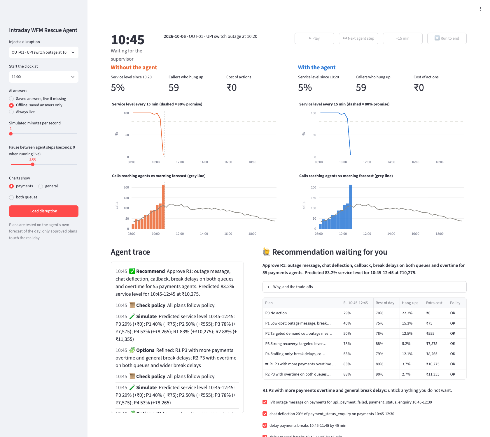
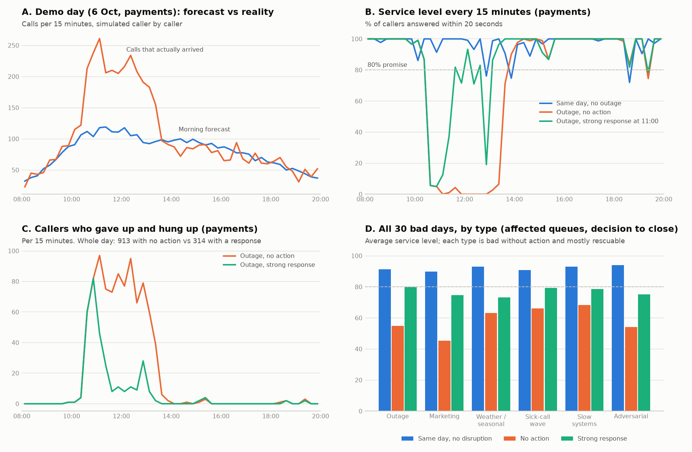
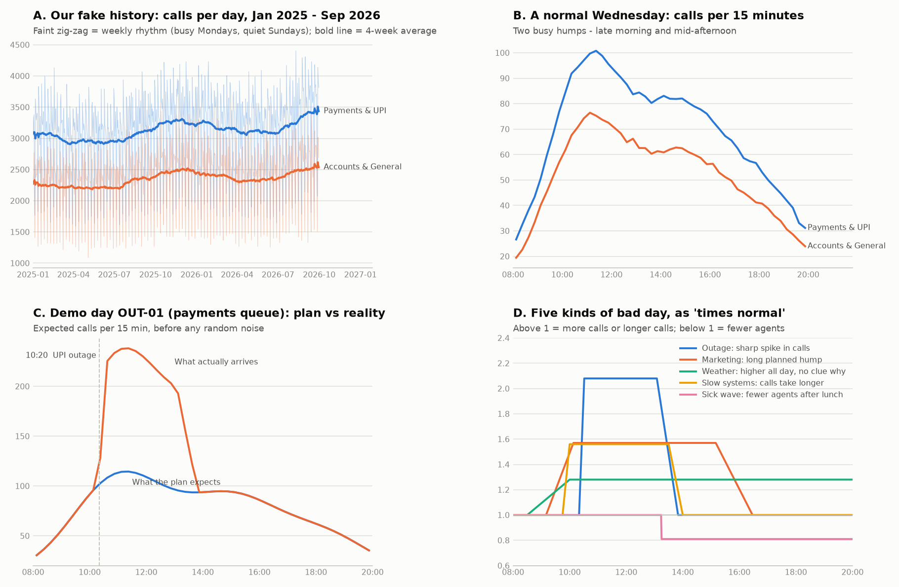

# Intraday WFM Rescue Agent

An AI agent that rescues a contact centre's day when real call volume breaks away from the
forecast: it detects the gap, diagnoses the cause with cited evidence, re-forecasts, tests
staffing fixes in a simulator, and recommends the cheapest plan that brings service level
back. A supervisor approves every action.

## Quick start

Needs [uv](https://docs.astral.sh/uv/) (it installs the right Python by itself).

```bash
make all      # install everything, build the data pack, run the checks
```

Or step by step: `make setup`, `make data`, `make test`.

## The demo dashboard

```bash
make demo        # opens the split-screen dashboard in your browser
```

Pick a disruption in the sidebar (the demo day, `OUT-01`, is first), choose **Offline: saved
answers only** for a demo that needs no internet, and press **Next agent step**. Bookmarkable
states: `http://localhost:8501/?scenario=OUT-01&start=09:45&mode=cached`.



## Pitch and safety net

| Command | What it does |
|---|---|
| `make offline-check` | Removes the API key and blocks any Claude connection, then plays the pitch path and every day in the picker from saved answers (about 2 min) |
| `make rehearse` | Three timed rehearsals of the pitch path in Chrome |
| `make video` | Re-records the backup video with captions and a spoken narration (the Mac's built-in voice, free), `media/demo_backup.mp4` |
| `make package` | Builds the submission zip in `dist/`, without `.env` or `.venv` |

The presenter's script, with timings and what to do if something fails, is in
[docs/pitch_script.md](docs/pitch_script.md).

## What's in the box (so far)

| Path | What it is |
|---|---|
| `config/contact_center.yaml` | The fictional centre: hours, queues, service-level target, demand shape, costs |
| `config/levers.yaml` | The fixes the agent may propose, each with cost, delay and hard limit |
| `wfm/schemas.py` | Shared data formats every component exchanges ([guide](docs/interfaces.md)) |
| `wfm/data/demand_model.py` | Ground-truth demand used for history and for scenario days |
| `wfm/data/history.py` | Builds `data/history/intervals.csv` (21 months x 15-min intervals x 2 queues) |
| `wfm/data/scenarios.py` | Builds the 30 bad days + 1 control day ([table](docs/scenarios.md)) |
| `wfm/data/shocks.py` | How a shock bends the day over time |
| `wfm/forecast/sarima.py` | Morning forecast: SARIMA daily totals x recent intraday shape; September backtest |
| `wfm/staffing/erlang.py` | Erlang A staffing maths (service level, abandonment, agents needed) |
| `wfm/staffing/roster.py` | Morning staffing plan: shifts, breaks, lunch, coaching, cross-skilling |
| `wfm/sim/` | SimPy contact-centre simulator: pre-drawn callers, lever executor, engine, results and snapshots |
| `scripts/calibrate.py` | Proves every bad day is bad without action and mostly rescuable ([results](docs/calibration.md)) |
| `data/policy/` | WFM policy and labour rules (27 rules in 6 documents) for retrieval |
| `wfm/policy/rag.py` | Hybrid policy search: Chroma embeddings + BM25 keywords, fused by rank |
| `wfm/agent/` | The agent: detector, evidence tools, Claude diagnosis, re-forecast, LangGraph wiring, runner |
| `scripts/phase3_diagnose.py` | Runs the agent on all 31 days and scores the diagnoses ([results](docs/phase3_results.md)) |
| `wfm/sim/projection.py` | The agent's what-if world: real past + its own re-forecast of the future |
| `wfm/agent/options.py`, `recommend.py`, `policy_check.py` | Plan options (Claude), simulation, policy checks (code), choice (code) and explanation (Claude) |
| `wfm/agent/session.py` | A whole day: detect, plan, supervisor approval or rejection, execute, monitor, re-plan |
| `scripts/phase4_run.py` | Five full agent days plus the reject-overtime demo ([results](docs/phase4_results.md)) |
| `wfm/ui/controller.py` | Demo controller: one clock, two copies of the day, the pending decision (testable without a browser) |
| `app/dashboard.py` | Streamlit split-screen dashboard with live agent trace and the approve / edit / reject card |
| `wfm/baselines/` | Comparison approaches: rule-based playbook and plain LLM (no tools, no simulator, no checks) |
| `wfm/evaluation.py`, `scripts/run_eval.py` | Four-way evaluation on 30 bad days + 6 held-out days, resumable with a spend cap ([report](docs/eval_report.md), [failure case](docs/failure_case.md)) |
| `scripts/judge_explanations.py` | LLM judge for explanation quality + the 20-item human grading sheet (`docs/eval/label_sheet.csv`) |
| `scripts/replay_audit.py` | Replays every AI day from saved answers: proves results reproduce, records cost to produce |
| `tests/` | Automated checkpoint checks |
| `docs/PROGRESS.md` | Phase tracker and decisions log |
| `docs/learning_notes/` | Plain-language explanation of each phase |

`make all` takes about 2 minutes on a fresh copy; one simulated day replays in under 0.1 s. It never calls Claude.

**Claude API key:** put it in `.env` (see `.env.example`) and check with `make check-key`.
`make diagnose` runs the agent on all 31 days; Claude answers are saved in `data/llm_cache/`, so
re-runs and `WFM_LLM_MODE=cached` (the offline demo mode) are free.





## Design rules

- **Code does the maths, the agent reasons, a supervisor approves.** Forecasts, staffing,
  simulation, costs and policy limits are deterministic code, never the LLM.
- **Fixed seeds everywhere.** Every approach faces the identical day.
- **Feed text is untrusted.** Instructions found inside incidents or calendar entries are ignored and flagged.
