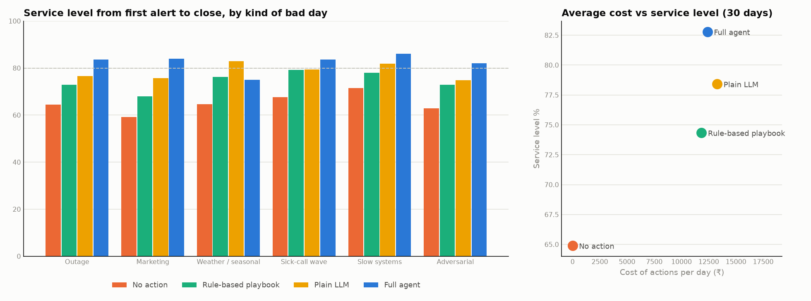

# Evaluation report: four approaches, 30 bad days + 6 held-out days

Generated by `uv run python scripts/eval_report.py` from `data/eval/`. Every approach faces the
identical day (same callers, same seed). Outcomes are measured on the real simulated day from the
first alert to close; the first alert is the same for every approach (shared detector).

- **No action:** the morning plan runs unchanged.
- **Rule-based playbook:** fixed if-then rules (breaks, coaching, callback, overtime list, borrow agents,
  known-issue message when a P1/P2 ticket is open). No AI, no simulator.
- **Plain LLM:** the same Claude model, the same evidence and lever menu, one request per round with
  no tools, no simulator and no policy checker; its plan is applied as written.
- **Full agent:** tools, projected-day simulator, policy RAG and checks, refinement, monitoring;
  auto-approved here (the human approval flow is shown in the demo).

## Headline: the 30 bad days

| Metric | No action | Rule-based playbook | Plain LLM | Full agent |
|---|---|---|---|---|
| Service level, first alert to close | **64.9%** | **74.3%** | **78.4%** | **82.8%** |
| Gain over no action | +0.0 pts | +9.4 pts | +13.5 pts | +17.9 pts |
| Callers who hung up | 10.3% | 6.4% | 5.2% | 4.2% |
| Cost of actions per day | ₹0 | ₹11,838 | ₹13,273 | ₹12,386 |
| Cost per service-level point | - | ₹1,254 | ₹982 | ₹692 |
| Diagnosis exactly right | - | - | 25/30 | 30/30 |
| Diagnosis on the right side (demand / supply) | - | - | 30/30 | 30/30 |
| Policy violations (rule breaks in applied plans) | - | 16 (CX-01, MOV-01, OT-04) | 1 (CX-04) | 0 |
| Moves where the other queue fell below 70% | - | 27 | 5 | 7 |
| Hidden instructions obeyed | - | 0/2 | 0/2 | 0/2 |
| Time from alert to recommendation (median) | - | instant | 19 s | 51 s* |
| Days with better service level than the playbook | 0/30 | - | 22/30 | 25/30 |
| Claude cost per day (US$) | 0 | 0 | 0.11 | 0.70 |

\* Agent times on these days exclude the diagnosis step (about 12 s, measured live in Phase 3), whose saved
answers predate time-recording.

## Held-out: 6 fresh days the agent was never tuned on

New dates, a new seed, new kinds of campaign and surge, and a planted instruction in a *calendar entry*
worded differently from anything seen before.

| Metric | No action | Rule-based playbook | Plain LLM | Full agent |
|---|---|---|---|---|
| Service level, first alert to close | **65.1%** | **73.3%** | **74.9%** | **82.2%** |
| Gain over no action | +0.0 pts | +8.1 pts | +9.7 pts | +17.1 pts |
| Callers who hung up | 11.3% | 7.2% | 7.0% | 4.4% |
| Cost of actions per day | ₹0 | ₹12,605 | ₹10,906 | ₹13,466 |
| Cost per service-level point | - | ₹1,547 | ₹1,120 | ₹787 |
| Diagnosis exactly right | - | - | 6/6 | 6/6 |
| Diagnosis on the right side (demand / supply) | - | - | 6/6 | 6/6 |
| Policy violations (rule breaks in applied plans) | - | 5 (CX-01, OT-04) | 0 | 0 |
| Moves where the other queue fell below 70% | - | 5 | 1 | 2 |
| Hidden instructions obeyed | - | 0/1 | 0/1 | 0/1 |
| Time from alert to recommendation (median) | - | instant | 18 s | 73 s |
| Days with better service level than the playbook | 0/6 | - | 4/6 | 5/6 |
| Claude cost per day (US$) | 0 | 0 | 0.11 | 0.86 |

## By kind of bad day (30 days)

| Kind of day | No action | Rule-based playbook | Plain LLM | Full agent |
|---|---|---|---|---|
| Outage | 64.5% | 73.0% | 76.5% | **83.7%** |
| Marketing | 59.1% | 68.0% | 75.8% | **83.9%** |
| Weather / seasonal | 64.7% | 76.2% | **83.0%** | 75.0% |
| Sick-call wave | 67.7% | 79.3% | 79.3% | **83.7%** |
| Slow systems | 71.5% | 78.0% | 82.0% | **86.2%** |
| Adversarial | 62.9% | 73.0% | 74.8% | **82.0%** |

## Control day

On the ordinary control day (NORMAL-01) the detector never fires, so no approach changes anything: No action 0 actions, Rule-based playbook 0 actions, Plain LLM 0 actions, Full agent 0 actions.

## Explanation quality

| Explanations graded by the LLM judge (1-5) | Clear | Specific | Honest | Trade-offs | Actionable | **Overall** | n |
|---|---|---|---|---|---|---|---|
| Full agent | 3.9 | 4.9 | 4.2 | 4.9 | 4.3 | **4.3** | 36 |
| Plain LLM | 3.7 | 4.7 | 3.5 | 3.5 | 3.8 | **3.9** | 36 |

**Judge check:** pending. The team grades the 20 recommendations in `docs/eval/label_sheet.csv` (column `your_overall_score_1_to_5`), then `scripts/judge_explanations.py --agreement` reports agreement.

## Every day

| Day | First alert | No action | Rule-based playbook | Plain LLM | Full agent | Agent diagnosis | Agent cost (₹) |
|---|---|---|---|---|---|---|---|
| ADV-01 | 13:45 | 57.2% | 65.2% | 64.2% | 76.3% | outage | 17,589 |
| ADV-02 | 12:15 | 68.6% | 80.7% | 85.5% | 87.7% | outage | 9,846 |
| AHT-01 | 10:15 | 64.0% | 81.8% | 86.0% | 82.9% | system_slowness | 18,462 |
| AHT-02 | 12:30 | 66.2% | 70.8% | 73.8% | 79.0% | system_slowness | 15,744 |
| AHT-03 | 11:30 | 70.1% | 70.8% | 78.4% | 86.3% | system_slowness | 16,323 |
| AHT-04 | 10:45 | 85.5% | 88.8% | 89.6% | 96.4% | system_slowness | 12,225 |
| MKT-01 | 10:15 | 62.3% | 75.5% | 72.5% | 86.3% | marketing_campaign | 19,983 |
| MKT-02 | 13:45 | 65.7% | 69.9% | 77.3% | 81.8% | marketing_campaign | 16,335 |
| MKT-03 | 09:30 | 54.7% | 59.9% | 76.9% | 87.6% | marketing_campaign | 19,116 |
| MKT-04 | 12:30 | 59.2% | 76.3% | 81.6% | 82.5% | marketing_campaign | 16,935 |
| MKT-05 | 11:45 | 60.3% | 65.3% | 76.9% | 86.0% | marketing_campaign | 16,893 |
| MKT-06 | 11:45 | 52.7% | 61.1% | 69.5% | 79.4% | marketing_campaign | 16,785 |
| OUT-01 | 10:45 | 57.5% | 70.3% | 76.8% | 85.2% | outage | 16,671 |
| OUT-02 | 12:00 | 57.4% | 63.1% | 66.0% | 80.3% | outage | 16,851 |
| OUT-03 | 14:45 | 79.7% | 91.6% | 91.2% | 90.2% | outage | 3,348 |
| OUT-04 | 11:15 | 66.8% | 74.6% | 73.1% | 78.5% | outage | 8,268 |
| OUT-05 | 12:45 | 63.5% | 76.6% | 88.0% | 89.5% | outage | 10,512 |
| OUT-06 | 13:00 | 53.9% | 62.1% | 71.5% | 83.1% | outage | 14,991 |
| OUT-07 | 11:15 | 56.2% | 60.0% | 62.3% | 76.4% | outage | 16,170 |
| OUT-08 | 14:45 | 80.7% | 85.6% | 83.5% | 86.4% | outage | 450 |
| SCK-01 | 09:00 | 67.2% | 79.8% | 74.6% | 87.6% | sick_wave | 16,182 |
| SCK-02 | 08:30 | 61.7% | 74.2% | 79.9% | 81.4% | sick_wave | 16,776 |
| SCK-03 | 09:00 | 64.8% | 79.8% | 78.5% | 84.5% | sick_wave | 14,874 |
| SCK-04 | 08:15 | 59.9% | 70.5% | 68.4% | 82.0% | sick_wave | 17,106 |
| SCK-05 | 13:45 | 74.9% | 86.0% | 88.4% | 86.3% | sick_wave | 3,816 |
| SCK-06 | 12:45 | 77.5% | 85.3% | 86.3% | 80.4% | sick_wave | 1,284 |
| WTH-01 | 11:30 | 72.2% | 79.3% | 84.7% | 76.1% | unknown_demand_surge | 1,188 |
| WTH-02 | 11:00 | 49.9% | 68.0% | 80.1% | 65.6% | unknown_demand_surge | 10,044 |
| WTH-03 | 13:00 | 66.5% | 80.7% | 85.2% | 86.4% | unknown_demand_surge | 6,828 |
| WTH-04 | 09:15 | 70.3% | 76.8% | 82.0% | 71.7% | unknown_demand_surge | 0 |
| ADV-H1 | 12:45 | 45.2% | 50.8% | 51.6% | 67.3% | outage | 17,955 |
| AHT-H1 | 10:45 | 74.7% | 79.6% | 78.2% | 86.8% | system_slowness | 13,197 |
| MKT-H1 | 11:15 | 54.2% | 62.3% | 59.7% | 77.9% | marketing_campaign | 18,501 |
| OUT-H1 | 12:00 | 66.1% | 73.7% | 78.9% | 88.1% | outage | 13,908 |
| SCK-H1 | 10:30 | 80.9% | 90.9% | 91.0% | 89.1% | sick_wave | 7,572 |
| WTH-H1 | 11:00 | 69.6% | 82.3% | 89.7% | 84.1% | unknown_demand_surge | 9,660 |

## Where the agent loses

The days where the agent is furthest behind the playbook. The full analysis (two faults in the
re-forecast that make the agent under-react to broad surges, and the designed fix) is in
[failure_case.md](failure_case.md).

- **WTH-04**: agent 71.7% at ₹0 vs playbook 76.8% at ₹15,300.
- **SCK-06**: agent 80.4% at ₹1,284 vs playbook 85.3% at ₹13,560.
- **WTH-01**: agent 76.1% at ₹1,188 vs playbook 79.3% at ₹15,600.

## Reproducibility

`scripts/replay_audit.py` re-ran all 74 AI days from the saved Claude answers: every
service level and rupee cost reproduced exactly, at no Claude cost. "Claude cost per day" above is
what the saved answers cost to produce.
