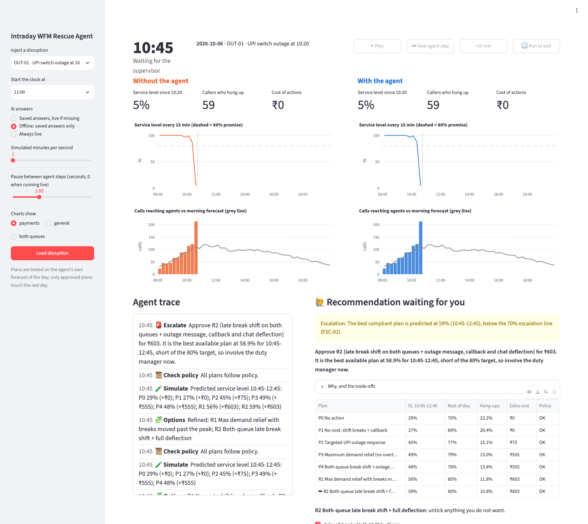

# Phase 5, explained in plain language

## The big idea of Phase 5

Everything so far worked, but only as text in a terminal. Phase 5 turns it into **the
screen the panel will watch**: one disruption, the same day shown twice, without and with
the agent, on one clock. You can see the agent think, and step in as the supervisor.

## What is on the screen

- **Clock and controls (top).** Play / Pause, "Next agent step" (jump to the next moment
  worth watching), "+15 min", "Run to end".
- **Left, orange: "Without the agent".** The morning plan runs unchanged.
- **Right, blue: "With the agent".** Same callers, same clock, but the agent acts.
  - Each side has three headline numbers (service level since the disruption began, callers
    who hung up, cost of actions) and two charts (service level every 15 minutes, and calls
    reaching agents against the morning forecast).
  - Thin blue vertical lines on the right mark the moments a plan was applied.
- **Agent trace (bottom left), in large type.** Every step appears as it finishes: detect,
  diagnose (with evidence), re-forecast, options, simulate, check policy, recommend, your
  decision, execute, monitor.
- **The decision card (bottom right).** It appears when the agent wants your approval:
  - a one-line headline, with the full reasoning folded underneath;
  - a table comparing every option (service level, hang-ups, extra cost, rule check);
  - a tick-box per action (untick to approve with edits);
  - a box for your reason if you reject.
  While it is open, the clock stops; the day waits for you.
- **Safety banners.** A red banner appears if a ticket contained a hidden instruction
  ("ignored and reported"), and another if the AI is unavailable.
- **Sidebar.** Pick the disruption, when the clock starts, how fast it runs, and how AI
  answers are produced:
  - **Saved answers, live if missing**: the default, fast and cheap.
  - **Offline**: no internet needed, your safety net.
  - **Always live**: every answer generated fresh.

## How we know it works

- **A robot clicks through the whole demo.** On every test run, Streamlit's built-in tester
  loads the outage day, steps to the recommendation, rejects it with "no overtime budget
  today", approves the re-plan, runs to the end, and checks there were no errors and that
  "Day complete" appears. It takes about 10 seconds and costs nothing.
- **Real browser screenshots.** Your installed Chrome was driven automatically to take the
  pictures in `docs/img/phase5_*.png`. Those pictures caught real problems:
  - an options table cut off;
  - a wall of text where a headline belonged;
  - a "+0 pts" arrow before the agent had done anything;
  - the old recommendation still showing while the agent re-planned.
  All were fixed.
- **Live mode checked once.** On a card-payment outage, the agent went from alarm to
  recommendation in 57 seconds using live Claude calls (19 US cents). That fits the
  pitch's 90-second "agent works live" slot.

## What the demo day looks like (rejecting overtime)

| From the 10:20 outage to close | Without the agent | With the agent |
|---|---|---|
| Service level | 41% | 65% |
| Callers who hung up | 907 | 339 |
| Cost of actions | Rs 0 | Rs 2,763 (no overtime) |

When overtime is refused, the agent says so honestly. Its best option reaches only 59% during
the outage, so it recommends that plan **and** asks for the duty manager. That is the kind of
judgement the panel should see.

## How to try it yourself

1. In the VS Code terminal: `make demo`. A browser tab opens.
2. In the sidebar, keep **OUT-01 · UPI switch outage at 10:20**, set *Start the clock at*
   09:45, choose **Offline: saved answers only**, and click **Load disruption**.
3. Press **Next agent step**. At 10:45 the agent diagnoses the outage and a recommendation
   appears.
4. Type `no overtime budget today` and click **Reject and re-plan**. Watch the trace.
5. Click **Approve**, then **Run to end**, approving any later recommendations.
6. Compare the two sides; download the audit log at the bottom right.

Tip: for the live pitch, type the rejection exactly as above in offline mode; a different
wording needs a live answer (use the default "saved answers, live if missing" mode).
