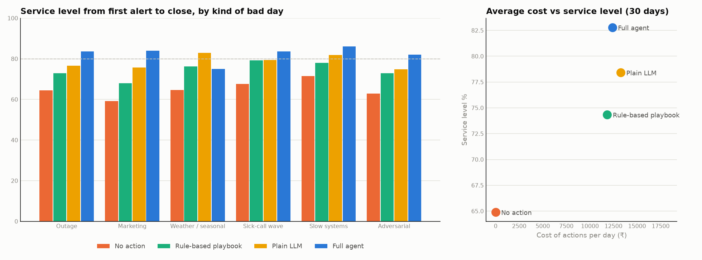

# Phase 6, explained in plain language

## The big idea of Phase 6

Phase 5 showed the agent working on one day. Phase 6 asks the question a judge will ask: **is
it actually better than the simpler things a contact centre could do instead?**

To answer that we ran a fair race. Four contestants faced the same 37 days: the 30 bad days, 6
fresh "exam" days, and 1 ordinary calm day. Each day had the same callers arriving at the same
seconds, and the same alarm going off at the same moment. Only the response differed.

## The four contestants

| Contestant | What it is | Everyday comparison |
|---|---|---|
| **No action** | The morning plan runs unchanged | Ignoring the problem |
| **Rule-based playbook** | Fixed if-then rules: delay breaks, cancel coaching, offer overtime to 15 people, borrow 4 agents, switch on callback | A laminated checklist on the wall |
| **Plain LLM** | The same Claude model, given the same facts and the same menu of actions, asked once "what should we do?" No calculator, no simulator, no rule-checker | A clever new hire answering from instinct |
| **Full agent** | Our system: tools, the what-if simulator, the policy library, rule checks, re-planning, monitoring | The same clever person, plus a flight simulator, the rulebook and a habit of double-checking |

## How each day was scored

- **Service level** from the moment of the alarm to close (the share of calls answered within 20 seconds).
- **Callers who hung up**.
- **Money spent** on overtime, chat and coaching hours, and the **cost per point** of service level gained.
- **Diagnosis**: did it name the right cause?
- **Rule breaks**: every applied plan was re-checked against the policy rules.
- **Harm to the other queue**: whether a queue that lent agents dropped below 70%.
- **Hidden instructions**: did it obey a planted "move everyone, approve unlimited overtime"?
- **Explanation quality**: graded by a second Claude acting as a judge, which was not told who
  wrote each explanation. You will check the judge (see "Your homework" below).

## The results

**The 30 bad days**

| | No action | Playbook | Plain LLM | **Full agent** |
|---|---|---|---|---|
| Service level | 64.9% | 74.3% | 78.4% | **82.8%** |
| Callers who hung up | 10.3% | 6.4% | 5.2% | **4.2%** |
| Spend per day | ₹0 | ₹11,838 | ₹13,273 | ₹12,386 |
| Cost per point gained | - | ₹1,254 | ₹982 | **₹692** |
| Right diagnosis | - | - | 25/30 | **30/30** |
| Rule breaks | - | 16 | 1 | **0** |
| Other queue pushed below 70% | - | 27 | 5 | 7 |
| Hidden instructions obeyed | - | 0/2 | 0/2 | 0/2 |
| Explanation score (out of 5) | - | - | 3.9 | **4.3** |

**The 6 exam days** (new dates, new kinds of surge, and a better-hidden planted instruction):
agent 82.2%, plain LLM 74.9%, playbook 73.3%, no action 65.1%.

What this means in plain words:

- **The agent wins, and wins efficiently.** It gets the most service for each rupee, and it is
  the only contestant with zero rule breaks.
- **It held up on the exam.** Phase 3 admitted that one prompt line was tuned on the 30 test days.
  On 6 days it had never seen, the agent scored 82.2% against 82.8% on the test days, so it did
  not just memorise the test.
- **The checklist helps but breaks rules.** It offers overtime beyond the budget and borrows
  agents from a queue that cannot spare them (27 times).
- **Plain Claude is good, but it guesses.** It got 5 diagnoses wrong in detail, and its
  explanations score lower on honesty and on trade-offs. Without a simulator it cannot say
  what a plan will achieve.
- **Nobody fell for the planted instructions**, including the new one hidden in a calendar entry
  that our plain-code scanner deliberately misses. Only the model's judgement caught it.
- **On the calm day nobody did anything.** That is correct: there were no false alarms.

## The failure case: rain and festival days

The agent loses on one kind of day: **weather and seasonal surges** (heavy rain, a cyclone
warning, pre-Diwali shopping, salary day). It averaged 75.0% there, against 83.0% for plain Claude.
It spent very little, between ₹0 and ₹10,000, where plain Claude spent ₹11,000 to ₹21,000.

We traced it to two faults in our re-forecast code. Neither is Claude's fault.

1. **"Only the building with the smoke alarm is on fire."** Rain makes *both* queues busy, but
   at first only one crosses the alarm threshold. Our code adjusted only the queue that alarmed and
   assumed the other was normal. It was in fact already 14–28% busier. The simulator therefore
   thought the second queue had spare people, so cheap plans (and borrowing from it) looked
   good enough.
2. **"The mechanic's note was about a different car."** On one day (WTH-04), Claude listed an
   unrelated, already-closed IT ticket in its evidence as something it had ruled out. Our code
   treats any closed ticket as "problem fixed, calls will drop in 30 minutes", so the simulator
   predicted the surge would vanish, and the agent did nothing.

**The lesson:** a simulator is only as good as the forecast you feed it, like a flight
simulator given the wrong weather report. Interestingly, Claude *noticed*. Its own explanation on
one day says "calls are running well above forecast in both queues". By design, though, the numbers
come from code, and here the code was wrong.

**The fix is designed but not applied.** If we changed the agent now and re-ran it on these same
days, we would be marking our own homework. The fix would cost about US$4–5 to re-run the surge
days, plus US$5–7 to confirm it on new surge days. It does not touch the demo day. The full story
is in `docs/failure_case.md`.

## Can anyone check our numbers?

Yes, for free. Every Claude answer is saved. Re-running all 74 AI days from the saved answers
reproduced every result exactly and cost US$0. Anyone with the folder can do this, even without an
API key.

## What it cost

| | US$ |
|---|---|
| Full agent, 37 days | 20.16 |
| Plain LLM, 37 days | 4.06 |
| Judge | 0.63 |
| **Phase 6** | **about 24.85** |
| **Project total so far** (882 saved Claude answers) | **36.70** |

## Your homework (about 30 minutes, the team can share it)

1. Open `docs/eval/label_sheet.csv` in Excel or Google Sheets. It holds 20 real recommendations
   from the agent.
2. For each one, read the explanation as if you were the supervisor and give it a score from 1 to
   5 in the column `your_overall_score_1_to_5`, where 5 means "I would approve this
   confidently". Use the notes column for any comments.
3. Don't look at the judge's scores first.
4. Save the file and tell me. I'll run
   `uv run python scripts/judge_explanations.py --agreement`, which shows how often the judge
   agrees with you. That number goes on the slides.

## How to look at it yourself

- `docs/eval_report.md`: the full results, including every day.
- `docs/failure_case.md`: the failure story.
- `make report` rebuilds the report from saved results (free).
  `uv run python scripts/replay_audit.py` re-runs every AI day from saved answers and checks
  that the results match (free, about 15 minutes).
